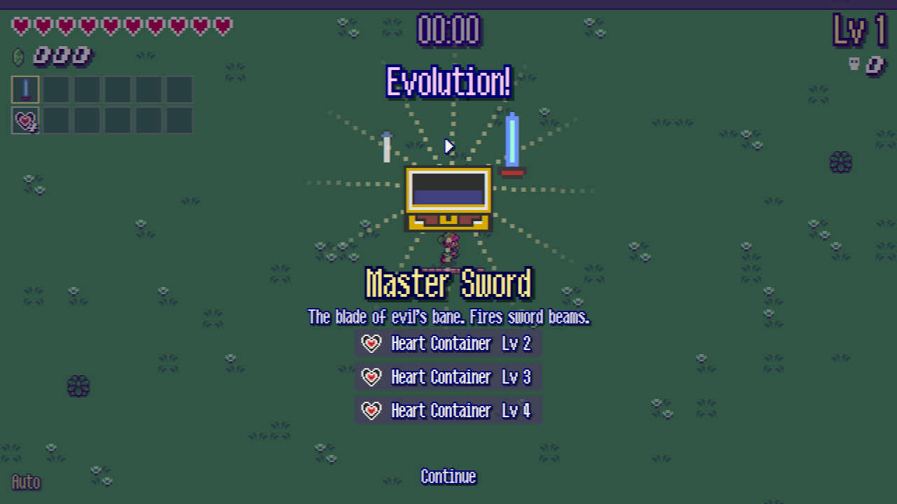
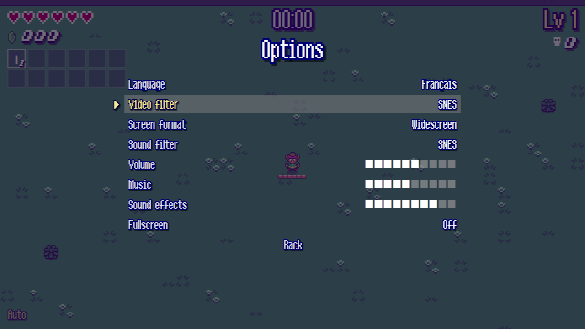
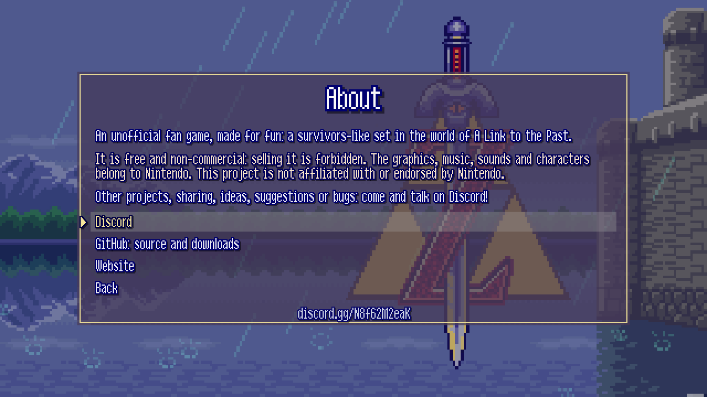

<p align="center"></p>
<h1 align="center">A Survivor to the Past</h1>
<p align="center"><i>Ein Survivors-like in der Welt von <b>A Link to the Past</b>: Halte den Monsterhorden Hyrules stand.</i></p>
<p align="center"><a href="https://discord.gg/N8f62M2eaK"></a> <a href="https://github.com/BigFatDeuce/A-Survivor-to-the-Past/releases"></a> <a href="LICENSE"></a> </p>
<p align="center"><a href="https://github.com/BigFatDeuce/A-Survivor-to-the-Past/releases/latest"><b>⬇ Für Windows herunterladen</b></a></p>
<p align="center"><a href="README.md">English</a> · <a href="README.fr.md">Français</a> · <b>Deutsch</b> · <a href="README.es.md">Español</a> · <a href="README.it.md">Italiano</a> · <a href="README.pt.md">Português</a> · <a href="README.ja.md">日本語</a></p>

<p align="center"></p>

## Worum geht es?

**A Survivor to the Past** ist ein inoffizielles Fan-Spiel, aus Spaß gemacht. Es verbindet das Prinzip der *Survivors-likes* (deine Waffen greifen von selbst an, die Wellen hören nie auf, jede Stufe bringt neue Kräfte) mit den Sprites, der Musik und den Klängen von *The Legend of Zelda: A Link to the Past* (SNES, 1991).

Steuere Link durch immer größere Horden, sammle Rubine, um aufzusteigen, wähle eine von drei Verbesserungen, öffne die Truhen der Elite-Gegner und entwickle deine Waffen zu ihren legendären Formen. Bei 5:00 erscheint ein Boss.

## Inhalt

- **8 Waffen**, jede mit einer **Entwicklung**, und **8 passive Gegenstände** — 6 Waffen- und 6 Gegenstandsplätze: Jede Wahl zählt
- **15 Gegnertypen** aus Hyrule, **Elite-Gegner**, die Truhen fallen lassen, und ein **Boss** (Hinox) bei 5:00
- Automatische Angriffe oder jederzeit **manuelles Zielen** (Tastatur, Maus oder Controller)
- Originale **Grafik, Musik und Klänge** von A Link to the Past (SNES)
- **Retro-Videofilter**: SNES (Standard), CRT, Scanlines, Game Boy Advance, Game Boy, dazu ein **4:3**-Modus — und passende **Audiofilter**
- **7 Sprachen**: English, Français, Deutsch, Español, Italiano, Português, 日本語
- Eigene **Rust-Engine** (wgpu): Tausende Gegner auf dem Bildschirm, stets flüssig

## Waffen und Entwicklungen

| Waffe | + Gegenstand (beliebige Stufe) | Entwicklung (Waffe auf Höchststufe) |
|---|---|---|
| Kämpferschwert | Herzcontainer | **Master-Schwert** |
| Bogen | Köcher | **Silberpfeile** |
| Bumerang | Pegasus-Stiefel | **Magischer Bumerang** |
| Feuerstab | Laterne | **Bombos-Medaillon** |
| Eisstab | Halbe Magie | **Äther-Medaillon** |
| Zauberhammer | Krafthandschuh | **Beben-Medaillon** |
| Bomben | Spiegelschild | **Superbombe** |
| Byrna-Stab | Käfernetz | **Feenreigen** |

## Bilder

<table>
<tr>
<td width="50%" align="center"><br><sub>Titelbildschirm</sub></td>
<td width="50%" align="center"><br><sub>Stufenaufstieg: 1 aus 3 wählen</sub></td>
</tr>
<tr>
<td width="50%" align="center"><br><sub>Entwicklungstruhe</sub></td>
<td width="50%" align="center"><br><sub>Boss: Hinox</sub></td>
</tr>
<tr>
<td width="50%" align="center"><br><sub>Optionen (Sprache, Filter, Lautstärke)</sub></td>
<td width="50%" align="center"><br><sub>Über das Spiel</sub></td>
</tr>
</table>

<p align="center"><br><sub>Videofilter: keiner · CRT / Game Boy Advance · Game Boy / Scanlines · CRT in 4:3</sub></p>

## Spielen

Das Spiel ist in der **Alpha-Phase** (Version 0.2.0). **Windows**: Lade die neueste Version von der [Release-Seite](https://github.com/BigFatDeuce/A-Survivor-to-the-Past/releases/latest) herunter, entpacke das ganze Zip und starte `A Survivor to the Past.exe`. Windows warnt eventuell, dass das Spiel nicht signiert ist: Klicke auf *Weitere Informationen* → *Trotzdem ausführen*. Danach **aktualisiert sich das Spiel selbst**: Beim Start prüft es auf GitHub, ob es eine neue Version gibt, lädt sie im Hintergrund herunter und installiert sie beim nächsten Start (Optionen → Updates: Automatisch / Nachfragen / Aus). Deine Einstellungen bleiben erhalten, und es wird nur GitHub kontaktiert, ohne persönliche Daten.

Versionen für Linux, macOS, Android und Browser folgen, sobald das Spiel fertig ist. Bis dahin kannst du es mit [Rust](https://rustup.rs) (stable) aus dem Quellcode bauen:

```sh
git clone https://github.com/BigFatDeuce/A-Survivor-to-the-Past.git
cd A-Survivor-to-the-Past
cargo run --release -p game
```

Unter Linux werden außerdem die Entwicklungspakete für ALSA und udev benötigt (`libasound2-dev`, `libudev-dev`).

## Steuerung

| Aktion | Tastatur / Maus | Controller |
|---|---|---|
| Bewegen | WASD / Pfeiltasten | Linker Stick / Steuerkreuz |
| Angreifen (manuell) | J / Linksklick | X / rechter Trigger |
| Sprint | Leertaste / Rechtsklick | A / linker Trigger |
| Auto- oder manueller Angriff | Tab / R | Y |
| Pause | Esc / P | Start |
| Vollbild · Info · Bildschirmfoto | F11 · F3 · F12 |  |

## Fahrplan

- Echte Karten (zuerst die Lichtwelt) und weitere spielbare Figuren
- Online-Bestenliste für jede Karte, mit frei wählbarem Spitznamen
- Bestiarium, Waffenkammer und Statistiken
- Export / Import von Spielständen und automatische Updates
- Versionen für Windows, Linux, macOS, Android und Browser

## Community

Dies ist ein Projekt aus Spaß. Für andere Projekte, Austausch, Ideen, Vorschläge oder Fehlerberichte: komm auf den **[Discord](https://discord.gg/N8f62M2eaK)**.

Webseite: [a-survivor-to-the-past.holy-c.men](https://a-survivor-to-the-past.holy-c.men/)

---

## Rechtliches

**A Survivor to the Past** ist ein **inoffizielles, kostenloses und nicht kommerzielles Fan-Spiel**, aus Spaß gemacht. **Der Verkauf des Spiels oder von Teilen davon ist verboten.**

*The Legend of Zelda*, *A Link to the Past*, ihre Figuren, Grafiken, Musik und Soundeffekte sind Marken und urheberrechtlich geschützte Werke von **Nintendo**. Alle hier verwendeten Nintendo-Assets gehören Nintendo. Dieses Projekt steht in keiner Verbindung zu Nintendo und wird von Nintendo weder gesponsert noch unterstützt.

Die [GPL-3.0-Lizenz](LICENSE) gilt nur für den für dieses Projekt geschriebenen Quellcode; sie gewährt keinerlei Rechte an Nintendos Assets. Die Sprite-Sheets stammen aus den Rips der Community von *The Spriters Resource* — danke an ihre Autoren.

Rechteinhaber: Um Inhalte entfernen zu lassen, eröffne ein Issue oder kontaktiere uns auf [Discord](https://discord.gg/N8f62M2eaK).
