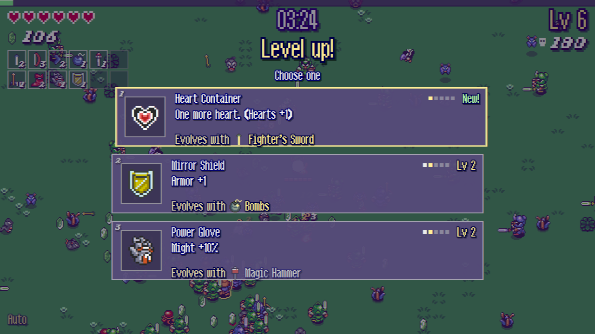

<p align="center"></p>
<h1 align="center">A Survivor to the Past</h1>
<p align="center"><i>Ein Survivors-like in der Welt von <b>A Link to the Past</b>: Halte den Monsterhorden Hyrules stand.</i></p>
<p align="center"><a href="https://discord.gg/N8f62M2eaK"></a> <a href="https://github.com/BigFatDeuce/A-Survivor-to-the-Past/releases"></a> <a href="LICENSE"></a> </p>
<p align="center"><a href="https://github.com/BigFatDeuce/A-Survivor-to-the-Past/releases/latest"><b>⬇ Herunterladen</b></a> · <a href="https://a-survivor-to-the-past.holy-c.men/play/"><b>▶ Im Browser spielen</b></a></p>
<p align="center"><a href="README.md">English</a> · <a href="README.fr.md">Français</a> · <b>Deutsch</b> · <a href="README.es.md">Español</a> · <a href="README.it.md">Italiano</a> · <a href="README.pt.md">Português</a> · <a href="README.ja.md">日本語</a></p>

<p align="center"></p>

## Worum geht es?

**A Survivor to the Past** ist ein inoffizielles Fan-Spiel, aus Spaß gemacht. Es verbindet das Prinzip der *Survivors-likes* (deine Waffen greifen von selbst an, die Wellen hören nie auf, jede Stufe bringt neue Kräfte) mit den Sprites, der Musik und den Klängen von *The Legend of Zelda: A Link to the Past* (SNES, 1991).

Steuere Link durch immer größere Horden, sammle Rubine, um aufzusteigen, wähle eine von drei Verbesserungen, öffne die Truhen der Elite-Gegner und entwickle deine Waffen zu ihren legendären Formen. Jede Stage dauert etwa zehn Minuten: Bei 4:30 kommt ein Zwischenboss, bei 9:00 der Endboss, und sein Sieg öffnet den Ausgang. Zwischen den Runden gibst du deine Rubine für dauerhafte Verbesserungen aus.

## Inhalt

- **10 Stages** in der Reihenfolge des Originals — Hyrule-Ebene, Wüste der Mysterien, Todesberg, Schloss Hyrule, Palast der Finsternis, Sumpf, Verlorene Wälder, Diebesdorf, Gefrorener See und Pyramide der Macht — jede mit eigenem Wetter, eigener Musik, Zwischen- und Endboss, bis zu Agahnim und Ganon
- **357 spielbare Figuren** in sechs Welten — die handgemachte Truppe (Link, Minish-Link, Sonic, Zelda, Mario, Vivi, die Truppe aus *Clair Obscur: Expedition 33*, Ganondorf als Allerletzter...) und über 300 Sprites der *A Link to the Past Randomizer*-Community, jeweils mit Nennung der Autoren und bis zu vier Farben (blaues Kettenhemd, rotes Kettenhemd, Hase). Manche werden durch Erfolge freigeschaltet (Gegner, Bosse, Level, Stages), andere mit roten Rubinen gekauft — jede mit Stärken, Schwächen und Startwaffe
- Ein seltener **Bob-omb**, der alle Gegner auf dem Bildschirm wegsprengt, und **zerstörbare Umgebung** mit Rubinen, Herzen, Feen oder dem Äther-Medaillon
- Zufällige **Begegnungen**: Ein wandernder Champion wartet irgendwo, ein Pfeil zeigt den Weg — besiege ihn für einen Segen, eine Spezialverbesserung oder ein Relikt, das bleibt, wenn du gewinnst
- Ein **diebischer Boo**, der dir nach und nach Rubine stiehlt — fang ihn, um sie zurückzubekommen
- Die **Wahrsagerin** nach dem Endboss (Truhenspiel, doppelt oder nichts) und eine **Hexe**, die Tränke für den ganzen Lauf verkauft
- **18 Waffen** (sechs davon von Zwischenbossen erbeutet) und das **Master-Schwert** für den Sieg über Ganon, jede mit ihrer **Fusion**, und **12 passive Gegenstände** — 6 Waffen- und 6 Gegenstandsplätze, jede Wahl zählt
- **Über 30 Gegnertypen** aus Hyrule, **12 Bosse** (in jeder Stage ein anderer) und **Elite-Gegner**, die Truhen fallen lassen
- **Fortschritt zwischen den Runden**: der Laden von Kakariko (dauerhafte Verbesserungen), die Segen der Großen Fee, eine **Reliquie** pro Stage, 4 **Schwierigkeitsgrade** und Ganons **Siegel** für mehr Rubine
- **Sammlung** (Bestiarium mit animierten Karten, ausführliche Karten zu Waffen, Gegenständen und Fusionen) und eine **Galerie**, in der Link zwischen seinen Trophäen, Waffen, Figuren und den Statuen der freigeschalteten Figuren umhergeht; **Erfolge** (59 Trophäen in Bronze, Silber und Gold, Statistiken); Export / Import des Spielstands als Textcode; rote Rubine kaufen auch Outfits, Musikstücke und Titel für die Rangliste
- **5 Spieler** auf demselben Computer, jeder mit Namen, Avatar und eigenem Fortschritt; eine **Punktzahl** für jede Runde und **Ranglisten**: Bestwerte pro Stage, unter den Spielern zu Hause und eine **Welt-Top-100** pro Spielversion, solo und im Koop
- **Online-Koop für 2 bis 4 Spieler** (Computer, Android und Browser): einen Raum erstellen und seinen Code aus 4 Buchstaben teilen; jeder spielt seine eigene Figur und Farbe, wählt Verbesserungen, ohne die anderen anzuhalten (10 Sekunden geschützt), und kann gefallene Mitspieler wiederbeleben; mit jedem Spieler werden die Gegner zäher und zahlreicher
- Eine **Spielanleitung** im Stil des Originalhefts (PDF, Englisch und Französisch)
- Automatische Angriffe oder jederzeit **manuelles Zielen** — Tastatur, Maus oder Controller, und **alle Tasten sind frei belegbar**
- Originale SNES-**Grafiken, Musik und Sounds** aus A Link to the Past
- **Retro-Videofilter**: SNES, CRT, Scanlines, Game Boy Advance, Game Boy, dazu ein **4:3**-Modus — und passende **Audiofilter**
- **7 Sprachen**: English, Français, Deutsch, Español, Italiano, Português, 日本語
- Eigene **Rust-Engine** (wgpu): Tausende Gegner auf dem Bildschirm, unter Windows, Linux, macOS, **Android** und **im Browser**

## Waffen und Entwicklungen

| Waffe | + Gegenstand | Entwicklung (beide auf Höchststufe) |
|---|---|---|
| Kämpferschwert | Herzcontainer | **Kampfschwert** |
| Bogen | Köcher | **Silberpfeile** |
| Bumerang | Zora-Flossen | **Magischer Bumerang** |
| Feuerstab | Laterne | **Bombos-Medaillon** |
| Eisstab | Halbe Magie | **Äther-Medaillon** |
| Zauberhammer | Krafthandschuh | **Beben-Medaillon** |
| Bomben | Spiegelschild | **Superbombe** |
| Byrna-Stab | Zauberumhang | **Feenreigen** |
| Enterhaken | Pegasus-Stiefel | **Lang-Enterhaken** |
| Zauberpulver | Pilz | **Hexenpulver** |
| Somaria-Stab | Buch Mudora | **Große Somaria** |
| Bienen | Käfernetz | **Goldbienen** |
| Schleuder | Köcher | **Hyperschleuder** |
| Rocs Feder | Pegasus-Stiefel | **Rocs Cape** |
| Leuchtfeuer | Halbe Magie | **Blaues Leuchtfeuer** |
| Wirbelkrug | Zauberumhang | **Vaatis Krug** |
| Feen-Okarina | Buch Mudora | **Okarina der Zeit** |
| Dins Feuerinferno | Laterne | **Dins Zorn** |

## Bilder

<table>
<tr>
<td width="50%" align="center"><br><sub>Titelbildschirm</sub></td>
<td width="50%" align="center"><br><sub>Stage-Auswahl</sub></td>
</tr>
<tr>
<td width="50%" align="center"><br><sub>Figurenauswahl</sub></td>
<td width="50%" align="center"><br><sub>Todesberg (Bonus-Stage) und seine Leunen</sub></td>
</tr>
<tr>
<td width="50%" align="center"><br><sub>Stufenaufstieg: 1 aus 3 wählen</sub></td>
<td width="50%" align="center"><br><sub>Entwicklungstruhe</sub></td>
</tr>
<tr>
<td width="50%" align="center"><br><sub>Boss: Hinox</sub></td>
<td width="50%" align="center"><br><sub>Laden von Kakariko: dauerhafte Verbesserungen</sub></td>
</tr>
<tr>
<td width="50%" align="center"><br><sub>Optionen (Sprache, Filter, Lautstärke)</sub></td>
<td width="50%" align="center"><br><sub>Über das Spiel</sub></td>
</tr>
</table>

<p align="center"><br><sub>Videofilter: keiner · CRT / Game Boy Advance · Game Boy / Scanlines · CRT in 4:3</sub></p>

## Spielen

Das Spiel ist in der **Alpha-Phase** (Version 0.9.0). **Windows**: Lade die neueste Version von der [Release-Seite](https://github.com/BigFatDeuce/A-Survivor-to-the-Past/releases/latest) herunter, entpacke das ganze Zip und starte `A Survivor to the Past.exe`. Windows warnt eventuell, dass das Spiel nicht signiert ist: Klicke auf *Weitere Informationen* → *Trotzdem ausführen*. **Linux, macOS und Handhelds** (PortMaster, experimentell): gleiche Seite, nimm das Zip für dein System und folge seiner `README.txt`. **Android** (Smartphones und Tablets, Touch-Steuerung): gleiche Seite, lade die `.apk` herunter und öffne sie (erlaube Installationen aus deinem Browser); sie aktualisiert sich nicht selbst. Danach **aktualisiert sich das Spiel selbst**: Beim Start prüft es auf GitHub, ob es eine neue Version gibt, lädt sie im Hintergrund herunter und installiert sie beim nächsten Start (Optionen → Updates: Automatisch / Nachfragen / Aus). Deine Einstellungen bleiben erhalten und es werden keine persönlichen Daten gesendet: Updates kontaktieren nur GitHub, und die Weltrangliste kontaktiert die Website des Spiels nur, wenn du sie öffnest oder eine Punktzahl veröffentlichst (Spitzname und Punktzahl).

**Browser**: [direkt auf der Website spielen](https://a-survivor-to-the-past.holy-c.men/play/), ohne Installation. Am besten am Computer, in Chrome, Edge oder Firefox; dein Fortschritt wird im Browser gespeichert. Du kannst das Spiel auch mit [Rust](https://rustup.rs) (stable) aus dem Quellcode bauen:

```sh
git clone https://github.com/BigFatDeuce/A-Survivor-to-the-Past.git
cd A-Survivor-to-the-Past
cargo run --release -p game
```

Unter Linux werden außerdem die Entwicklungspakete für ALSA und udev benötigt (`libasound2-dev`, `libudev-dev`).

## Steuerung

| Aktion | Tastatur / Maus | Controller |
|---|---|---|
| Bewegen | WASD / Pfeiltasten | Linker Stick / Steuerkreuz |
| Angreifen (manuell) | J / Linksklick | X / rechter Trigger |
| Sprint | Leertaste / Rechtsklick | A / linker Trigger |
| Auto- oder manueller Angriff | Tab / R | Y |
| Pause | Esc / P | Start |
| Vollbild · Info · Bildschirmfoto | F11 · F3 · F12 | Select · – · – |

## Fahrplan

- Echte, handgemachte Karten und weitere spielbare Figuren
- Weitere Bosse mit eigenen Angriffen und Animationen

## Community

Dies ist ein Projekt aus Spaß. Für andere Projekte, Austausch, Ideen, Vorschläge oder Fehlerberichte: komm auf den **[Discord](https://discord.gg/N8f62M2eaK)**.

Webseite: [a-survivor-to-the-past.holy-c.men](https://a-survivor-to-the-past.holy-c.men/)

---

## Rechtliches

**A Survivor to the Past** ist ein **inoffizielles, kostenloses und nicht kommerzielles Fan-Spiel**, aus Spaß gemacht. **Der Verkauf des Spiels oder von Teilen davon ist verboten.**

*The Legend of Zelda*, *A Link to the Past*, *The Minish Cap*, ihre Figuren, Grafiken, Musik und Soundeffekte sind Marken und urheberrechtlich geschützte Werke von **Nintendo**. Alle hier verwendeten Nintendo-Assets gehören Nintendo. Dieses Projekt steht in keiner Verbindung zu Nintendo und wird von Nintendo weder gesponsert noch unterstützt.

Die [GPL-3.0-Lizenz](LICENSE) gilt nur für den für dieses Projekt geschriebenen Quellcode; sie gewährt keinerlei Rechte an Nintendos Assets. Die Sprite-Sheets stammen aus den Rips der Community von *The Spriters Resource* — danke an ihre Autoren.

Die Namen aller Sprite-Ripper und Künstler (Barack Obama, Mister Man, Nemau, Aztec Warrior, Deathbringer, Barubary, Vaati, Mister Mike, Ragnarockerbunny und viele mehr) stehen in **[CREDITS.md](CREDITS.md)**. Mario und Shy Guy gehören ebenfalls Nintendo; *Sonic the Hedgehog* ist eine Marke von **SEGA**, *Among Us* von **Innersloth**, Simon Belmont (*Castlevania*) von **Konami**, Vivi (*Final Fantasy IX*) von **Square Enix** und die Figuren aus *Clair Obscur: Expedition 33* von **Sandfall Interactive**.

Rechteinhaber: Um Inhalte entfernen zu lassen, eröffne ein Issue oder kontaktiere uns auf [Discord](https://discord.gg/N8f62M2eaK).
