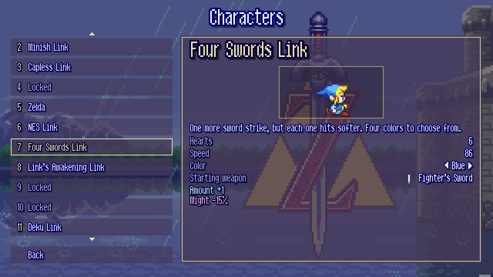
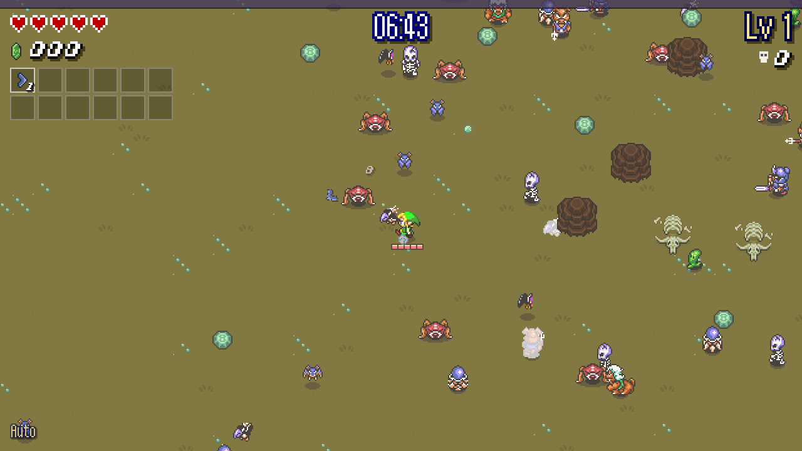

<p align="center"></p>
<h1 align="center">A Survivor to the Past</h1>
<p align="center"><i>Un survivors-like en el mundo de <b>A Link to the Past</b>: resiste a las hordas de monstruos de Hyrule.</i></p>
<p align="center"><a href="https://discord.gg/N8f62M2eaK"></a> <a href="https://github.com/BigFatDeuce/A-Survivor-to-the-Past/releases"></a> <a href="LICENSE"></a> </p>
<p align="center"><a href="https://github.com/BigFatDeuce/A-Survivor-to-the-Past/releases/latest"><b>⬇ Descargar para Windows</b></a> · <a href="https://a-survivor-to-the-past.holy-c.men/play/"><b>▶ Jugar en el navegador</b></a></p>
<p align="center"><a href="README.md">English</a> · <a href="README.fr.md">Français</a> · <a href="README.de.md">Deutsch</a> · <b>Español</b> · <a href="README.it.md">Italiano</a> · <a href="README.pt.md">Português</a> · <a href="README.ja.md">日本語</a></p>

<p align="center"></p>

## ¿Qué es?

**A Survivor to the Past** es un fangame no oficial, hecho por diversión. Mezcla la fórmula de los *survivors-like* (tus armas atacan solas, las oleadas nunca se detienen, cada nivel trae nuevos poderes) con los sprites, la música y los sonidos de *The Legend of Zelda: A Link to the Past* (Super Nintendo, 1991).

Guía a Link entre hordas cada vez más grandes, recoge rupias para subir de nivel, elige una mejora entre tres, abre los cofres que sueltan las élites y haz evolucionar tus armas a sus formas legendarias. Cada fase dura unos diez minutos: un jefe intermedio llega a los 4:30, el jefe final a los 9:00, y vencerlo abre la salida. Entre partidas, gasta tus rupias en mejoras permanentes.

## Contenido

- **6 fases** que se desbloquean una tras otra — Llanura de Hyrule, Bosque Perdido, Desierto del Misterio, Lago helado, Pirámide del Poder y la Montaña de la Muerte como extra — cada una con su clima, su música, su jefe intermedio y su jefe final, hasta Agahnim y Ganon
- **13 personajes jugables** por desbloquear — Link, Link Minish, Link sin gorro, Sonic, la princesa Zelda, el Link de NES, el Link de *Four Swords* (4 colores), los de *Link's Awakening* y *Zelda II*, Link adulto, Link Deku, Shy Guy y Shadow Link (derrotando a Ganon) — cada uno con sus puntos fuertes, sus debilidades y su arma inicial
- Una **Bob-omb** rara que barre a todos los enemigos de la pantalla, y **decorado destructible** que esconde rupias, corazones, hadas o el medallón de Éter
- **Encuentros** aleatorios: un campeón errante espera en algún lugar y una flecha indica el camino — derrótalo para obtener una bendición, una mejora especial de arma o una reliquia que conservas si ganas
- **12 armas**, cada una con una **evolución**, y **12 objetos pasivos** — 6 huecos de armas y 6 de objetos: cada elección cuenta
- **17 tipos de enemigos** de Hyrule, **7 jefes** y **élites** que sueltan cofres
- **Progresión entre partidas**: la tienda de Kakariko (mejoras permanentes), las bendiciones de la Gran Hada, una **reliquia** por fase, 4 **dificultades** y los **sellos** de Ganon para ganar más rupias
- **Perfil**: bestiario, armería, estadísticas, y exportar / importar la partida como código de texto
- Ataques automáticos o **apuntado manual** en cualquier momento — teclado, ratón o mando, y **todas las teclas se pueden reasignar**
- **Gráficos, música y sonidos** originales de A Link to the Past en SNES
- **Filtros de vídeo retro**: SNES, CRT, Scanlines, Game Boy Advance, Game Boy, más un modo **4:3** — y **filtros de audio** a juego
- **7 idiomas**: English, Français, Deutsch, Español, Italiano, Português, 日本語
- **Motor propio en Rust** (wgpu): miles de enemigos en pantalla, en Windows y **en el navegador**

## Armas y evoluciones

| Arma | + Objeto (cualquier nivel) | Evolución (arma al nivel máximo) |
|---|---|---|
| Espada de luchador | Contenedor de corazón | **Espada Maestra** |
| Arco | Carcaj | **Flechas de plata** |
| Bumerán | Botas de Pegaso | **Bumerán mágico** |
| Vara de fuego | Lámpara | **Medallón Bombos** |
| Vara de hielo | Media magia | **Medallón Éter** |
| Martillo mágico | Guante de poder | **Medallón Temblor** |
| Bombas | Escudo espejo | **Superbomba** |
| Cetro de Byrna | Red cazabichos | **Corro de hadas** |
| Gancho | Aletas de Zora | **Supergancho** |
| Polvo mágico | Champiñón | **Polvo de la bruja** |
| Bastón de Somaria | Libro de Mudora | **Gran Somaria** |
| Abejas | Capa mágica | **Abejas doradas** |

## Capturas

<table>
<tr>
<td width="50%" align="center"><br><sub>Pantalla de título</sub></td>
<td width="50%" align="center"><br><sub>Selección de fase</sub></td>
</tr>
<tr>
<td width="50%" align="center"><br><sub>Selección de personaje</sub></td>
<td width="50%" align="center"><br><sub>Montaña de la Muerte (fase extra) y sus Lynels</sub></td>
</tr>
<tr>
<td width="50%" align="center"><br><sub>Subida de nivel: elige 1 de 3</sub></td>
<td width="50%" align="center"><br><sub>Cofre de evolución</sub></td>
</tr>
<tr>
<td width="50%" align="center"><br><sub>Jefe: Hinox</sub></td>
<td width="50%" align="center"><br><sub>Tienda de Kakariko: mejoras permanentes</sub></td>
</tr>
<tr>
<td width="50%" align="center"><br><sub>Opciones (idioma, filtros, volumen)</sub></td>
<td width="50%" align="center"><br><sub>Acerca de</sub></td>
</tr>
</table>

<p align="center"><br><sub>Filtros de vídeo: ninguno · CRT / Game Boy Advance · Game Boy / Scanlines · CRT en 4:3</sub></p>

## Jugar

El juego está en **alfa** (versión 0.5.0). **Windows**: descarga la última versión en la [página de versiones](https://github.com/BigFatDeuce/A-Survivor-to-the-Past/releases/latest), extrae todo el zip y ejecuta `A Survivor to the Past.exe`. Windows puede avisar de que el juego no está firmado: haz clic en *Más información* → *Ejecutar de todas formas*. Después, el juego **se actualiza solo**: al iniciarse comprueba en GitHub si hay una versión nueva, la descarga en segundo plano y la instala en el siguiente inicio (Opciones → Actualizaciones: Automáticas / Preguntar / No). Tus ajustes se conservan y solo se contacta con GitHub, sin ningún dato personal.

**Navegador**: [juega directamente en la web](https://a-survivor-to-the-past.holy-c.men/play/), sin instalar nada. Funciona mejor en ordenador, en Chrome, Edge o Firefox, y tu progreso se guarda en el navegador. Las versiones para Linux, macOS y Android llegarán más adelante. Mientras tanto, puedes compilar el juego desde el código fuente con [Rust](https://rustup.rs) (stable):

```sh
git clone https://github.com/BigFatDeuce/A-Survivor-to-the-Past.git
cd A-Survivor-to-the-Past
cargo run --release -p game
```

En Linux, instala también los paquetes de desarrollo de ALSA y udev (`libasound2-dev`, `libudev-dev`).

## Controles

| Acción | Teclado / ratón | Mando |
|---|---|---|
| Moverse | WASD / flechas | Stick izquierdo / cruceta |
| Atacar (modo manual) | J / clic izquierdo | X / gatillo derecho |
| Carrera | Espacio / clic derecho | A / gatillo izquierdo |
| Ataque automático o manual | Tab / R | Y |
| Pausa | Esc / P | Start |
| Pantalla completa · info · captura | F11 · F3 · F12 |  |

## Hoja de ruta

- Mapas de verdad hechos a mano y más personajes jugables
- Clasificación en línea para cada fase, con el apodo que elijas
- Más jefes con sus propios ataques y animaciones
- Controles táctiles para móviles y tabletas
- Versiones para Linux, macOS y Android

## Comunidad

Es un proyecto hecho por diversión. Para otros proyectos, compartir, ideas, propuestas o errores, ven al **[Discord](https://discord.gg/N8f62M2eaK)**.

Web: [a-survivor-to-the-past.holy-c.men](https://a-survivor-to-the-past.holy-c.men/)

---

## Aviso legal

**A Survivor to the Past** es un **fangame no oficial, gratuito y sin ánimo de lucro**, hecho por diversión. **Está prohibido venderlo, total o parcialmente.**

*The Legend of Zelda*, *A Link to the Past*, *The Minish Cap*, sus personajes, gráficos, música y efectos de sonido son marcas y obras protegidas de **Nintendo**. Todos los recursos de Nintendo usados aquí pertenecen a Nintendo. Este proyecto no está afiliado, patrocinado ni respaldado por Nintendo.

La [licencia GPL-3.0](LICENSE) solo cubre el código fuente escrito para este proyecto; no otorga ningún derecho sobre los recursos de Nintendo. Las hojas de sprites proceden de las extracciones compartidas por la comunidad de *The Spriters Resource* — gracias a sus autores.

El nombre de cada autor de extracciones o sprites (Barack Obama, Mister Man, Nemau, Aztec Warrior, Deathbringer, Barubary, Vaati, Mister Mike, Ragnarockerbunny y muchos más) aparece en **[CREDITS.md](CREDITS.md)**. Shy Guy también pertenece a Nintendo; *Sonic the Hedgehog* es una marca de **SEGA**.

Titulares de derechos: para retirar un contenido, abrid una issue o contactad con nosotros en [Discord](https://discord.gg/N8f62M2eaK).
