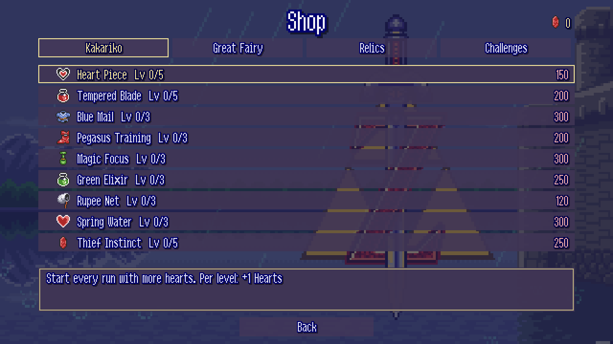

<p align="center"></p>
<h1 align="center">A Survivor to the Past</h1>
<p align="center"><i>Un survivors-like dans l'univers de <b>A Link to the Past</b> : tenez face aux hordes de monstres d'Hyrule.</i></p>
<p align="center"><a href="https://discord.gg/N8f62M2eaK"></a> <a href="https://github.com/BigFatDeuce/A-Survivor-to-the-Past/releases"></a> <a href="LICENSE"></a> </p>
<p align="center"><a href="https://github.com/BigFatDeuce/A-Survivor-to-the-Past/releases/latest"><b>⬇ Télécharger</b></a> · <a href="https://a-survivor-to-the-past.holy-c.men/play/"><b>▶ Jouer dans le navigateur</b></a></p>
<p align="center"><a href="README.md">English</a> · <b>Français</b> · <a href="README.de.md">Deutsch</a> · <a href="README.es.md">Español</a> · <a href="README.it.md">Italiano</a> · <a href="README.pt.md">Português</a> · <a href="README.ja.md">日本語</a></p>

<p align="center"></p>

## Qu'est-ce que c'est ?

**A Survivor to the Past** est un fan game non officiel, fait pour le plaisir. Il mélange la formule des *survivors-like* (vos armes attaquent seules, les vagues ne s'arrêtent jamais, chaque niveau apporte de nouveaux pouvoirs) avec les sprites, musiques et sons de *The Legend of Zelda: A Link to the Past* (Super Nintendo, 1991).

Guidez Link au milieu de hordes toujours plus grandes, ramassez des rubis pour monter de niveau, choisissez une amélioration parmi trois, ouvrez les coffres lâchés par les élites et faites évoluer vos armes vers leurs formes légendaires. Chaque stage dure une dizaine de minutes : un boss intermédiaire arrive à 4:30, le boss final à 9:00, et le vaincre ouvre la sortie. Entre deux parties, dépensez vos rubis en améliorations permanentes.

## Contenu

- **6 stages** à débloquer l'un après l'autre — Plaine d'Hyrule, Bois Perdus, Désert du Mystère, Lac gelé, Pyramide de la Puissance et la Montagne de la Mort en bonus — chacun avec sa météo, sa musique, son boss intermédiaire et son boss final, jusqu'à Agahnim et Ganon
- **350 personnages jouables** dans six univers — la troupe faite main (Link, Link Minish, Sonic, Zelda, Mario, Vivi, Ganondorf, le tout dernier...) et plus de 300 sprites de la communauté du *A Link to the Past Randomizer*, chacun crédité à ses auteurs, avec jusqu'à quatre couleurs (cotte bleue, cotte rouge, lapin). Certains se débloquent par des exploits (ennemis, boss, niveaux, stages), d'autres s'achètent en rubis rouges — chacun avec ses forces, ses faiblesses et son arme de départ
- Une **Bob-omb** rare qui souffle tous les ennemis à l'écran, et un **décor cassable** qui cache rubis, cœurs, fées ou médaillon d'Éther
- Des **rencontres** aléatoires : un champion errant attend quelque part, une flèche indique où aller — battez-le pour une bénédiction, une amélioration spéciale d'arme ou une relique gardée si vous gagnez
- Un **Boo voleur** qui dévore les rubis restés au sol — rattrapez-le pour tout récupérer
- **12 armes**, chacune avec une **évolution**, et **12 objets passifs** — 6 emplacements d'armes et 6 d'objets : chaque choix compte
- **18 types d'ennemis** d'Hyrule, **12 boss** (un différent à chaque stage) et des **élites** qui lâchent des coffres
- **Progression entre les parties** : la boutique de Cocorico (améliorations permanentes), les bénédictions de la Grande Fée, une **relique** gagnée sur chaque stage, 4 **difficultés** et les **sceaux** de Ganon pour gagner plus de rubis
- **Profil** : bestiaire, armurerie, statistiques, et export / import de la sauvegarde sous forme de code texte
- **5 joueurs** sur le même ordinateur, chacun avec son nom, son avatar et sa progression ; un **score** à chaque partie et des **classements** : meilleurs scores par stage, entre les joueurs de la maison et **top 100 mondial** par version du jeu
- Un **livret d'instructions** à la manière de celui d'origine (PDF, français et anglais)
- Attaques automatiques, ou **visée manuelle** à tout moment — clavier, souris ou manette, et **toutes les touches sont reconfigurables**
- **Graphismes, musiques et sons** originaux de A Link to the Past sur SNES
- **Filtres vidéo rétro** : SNES, CRT, Scanlines, Game Boy Advance, Game Boy, plus un mode **4:3** — et des **filtres audio** assortis
- **7 langues** : English, Français, Deutsch, Español, Italiano, Português, 日本語
- **Moteur maison en Rust** (wgpu) : des milliers d'ennemis à l'écran, sur Windows, Linux, macOS et **dans le navigateur**

## Armes et évolutions

| Arme | + Objet | Évolution (les deux au niveau max) |
|---|---|---|
| Épée du chevalier | Réceptacle de coeur | **Épée de combat** |
| Arc | Carquois | **Flèches d'argent** |
| Boomerang | Palmes de Zora | **Boomerang magique** |
| Baguette de feu | Lanterne | **Médaillon Bombos** |
| Baguette de glace | Demi-magie | **Médaillon Éther** |
| Marteau magique | Gant de puissance | **Médaillon Séisme** |
| Bombes | Bouclier miroir | **Super bombe** |
| Canne de Byrna | Cape magique | **Ronde des fées** |
| Grappin | Bottes de Pégase | **Super grappin** |
| Poudre magique | Champignon | **Poudre de la sorcière** |
| Canne de Somaria | Livre de Mudora | **Grande Somaria** |
| Abeilles | Filet à papillons | **Abeilles dorées** |
| Lance-pierre | Carquois | **Hyper lance-pierre** |
| Plume de Roc | Bottes de Pégase | **Cape de Roc** |
| Fanal | Demi-magie | **Fanal bleu** |
| Jarre magique | Cape magique | **Jarre de Vaati** |
| Ocarina des fées | Livre de Mudora | **Ocarina du temps** |
| Feu de Din | Lanterne | **Courroux de Din** |

## Captures d'écran

<table>
<tr>
<td width="50%" align="center"><br><sub>Écran titre</sub></td>
<td width="50%" align="center"><br><sub>Choix du stage</sub></td>
</tr>
<tr>
<td width="50%" align="center"><br><sub>Choix du personnage</sub></td>
<td width="50%" align="center"><br><sub>Montagne de la Mort (stage bonus) et ses Lynels</sub></td>
</tr>
<tr>
<td width="50%" align="center"><br><sub>Niveau supérieur : 1 choix parmi 3</sub></td>
<td width="50%" align="center"><br><sub>Coffre d'évolution</sub></td>
</tr>
<tr>
<td width="50%" align="center"><br><sub>Boss : Hinox</sub></td>
<td width="50%" align="center"><br><sub>Boutique de Cocorico : améliorations permanentes</sub></td>
</tr>
<tr>
<td width="50%" align="center"><br><sub>Options (langue, filtres, volumes)</sub></td>
<td width="50%" align="center"><br><sub>À propos</sub></td>
</tr>
</table>

<p align="center"><br><sub>Filtres vidéo : aucun · CRT / Game Boy Advance · Game Boy / Scanlines · CRT en 4:3</sub></p>

## Jouer

Le jeu est en **alpha** (version 0.7.0). **Windows** : téléchargez la dernière version sur la [page des versions](https://github.com/BigFatDeuce/A-Survivor-to-the-Past/releases/latest), extrayez tout le zip et lancez `A Survivor to the Past.exe`. Windows peut prévenir que le jeu n'est pas signé : cliquez sur *Informations complémentaires* → *Exécuter quand même*. **Linux, macOS et consoles portables** (PortMaster, expérimental) : même page, prenez le zip de votre système et suivez son `README.txt`. Ensuite, le jeu **se met à jour tout seul** : au lancement, il vérifie sur GitHub s'il existe une nouvelle version, la télécharge en arrière-plan et l'installe au lancement suivant (Options → Mises à jour : Automatiques / Me demander / Non). Vos réglages sont conservés et aucune donnée personnelle n'est envoyée : les mises à jour ne contactent que GitHub, et le classement mondial ne contacte le site du jeu que lorsque vous l'ouvrez ou publiez un score (pseudo et score).

**Navigateur** : [jouez directement sur le site](https://a-survivor-to-the-past.holy-c.men/play/), sans rien installer. Idéal sur ordinateur, dans Chrome, Edge ou Firefox ; votre progression est enregistrée dans le navigateur. Les versions Linux, macOS et Android viendront plus tard. En attendant, vous pouvez compiler le jeu depuis les sources avec [Rust](https://rustup.rs) (stable) :

```sh
git clone https://github.com/BigFatDeuce/A-Survivor-to-the-Past.git
cd A-Survivor-to-the-Past
cargo run --release -p game
```

Sous Linux, installez aussi les paquets de développement ALSA et udev (`libasound2-dev`, `libudev-dev`).

## Commandes

| Action | Clavier / souris | Manette |
|---|---|---|
| Se déplacer | ZQSD / flèches | Stick gauche / croix |
| Attaquer (mode manuel) | J / clic gauche | X / gâchette droite |
| Dash | Espace / clic droit | A / gâchette gauche |
| Attaque auto ou manuelle | Tab / R | Y |
| Pause | Échap / P | Start |
| Plein écran · infos · capture | F11 · F3 · F12 | Select · – · – |

## Feuille de route

- De vraies cartes dessinées à la main et d'autres personnages jouables
- D'autres boss avec leurs propres attaques et animations
- Commandes tactiles pour téléphones et tablettes
- Versions Linux, macOS et Android

## Communauté

C'est un projet fait pour le plaisir. Pour d'autres projets, partager, proposer des idées ou signaler des bugs, rendez-vous sur le **[Discord](https://discord.gg/N8f62M2eaK)**.

Site : [a-survivor-to-the-past.holy-c.men](https://a-survivor-to-the-past.holy-c.men/)

---

## Mentions légales

**A Survivor to the Past** est un **fan game non officiel, gratuit et non commercial**, fait pour le plaisir. **Sa revente, totale ou partielle, est interdite.**

*The Legend of Zelda*, *A Link to the Past*, *The Minish Cap*, leurs personnages, graphismes, musiques et effets sonores sont des marques et des œuvres protégées de **Nintendo**. Tous les assets Nintendo utilisés ici appartiennent à Nintendo. Ce projet n'est ni affilié à Nintendo, ni sponsorisé, ni approuvé par Nintendo.

La [licence GPL-3.0](LICENSE) ne couvre que le code source écrit pour ce projet ; elle ne donne aucun droit sur les assets de Nintendo. Les planches de sprites proviennent des extractions partagées par la communauté de *The Spriters Resource* — merci à leurs auteurs.

Le nom de chaque auteur d'extraction ou de sprite (Barack Obama, Mister Man, Nemau, Aztec Warrior, Deathbringer, Barubary, Vaati, Mister Mike, Ragnarockerbunny et bien d'autres) figure dans **[CREDITS.md](CREDITS.md)**. Mario et Maskass appartiennent eux aussi à Nintendo ; *Sonic the Hedgehog* est une marque de **SEGA**, *Among Us* d'**Innersloth**, Simon Belmont (*Castlevania*) de **Konami**, et Vivi (*Final Fantasy IX*) de **Square Enix**.

Ayants droit : pour faire retirer un contenu, ouvrez une issue ou contactez-nous sur le [Discord](https://discord.gg/N8f62M2eaK).
