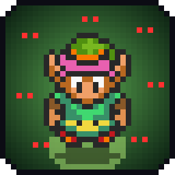

<p align="center"></p>
<h1 align="center">A Survivor to the Past</h1>
<p align="center"><i>Un survivors-like dans l'univers de <b>A Link to the Past</b> : tenez face aux hordes de monstres d'Hyrule.</i></p>
<p align="center"><a href="https://discord.gg/N8f62M2eaK"></a> <a href="https://github.com/BigFatDeuce/A-Survivor-to-the-Past/releases"></a> <a href="LICENSE"></a> </p>
<p align="center"><a href="README.md">English</a> · <b>Français</b> · <a href="README.de.md">Deutsch</a> · <a href="README.es.md">Español</a> · <a href="README.it.md">Italiano</a> · <a href="README.pt.md">Português</a> · <a href="README.ja.md">日本語</a></p>

<p align="center"></p>

## Qu'est-ce que c'est ?

**A Survivor to the Past** est un fan game non officiel, fait pour le plaisir. Il mélange la formule des *survivors-like* (vos armes attaquent seules, les vagues ne s'arrêtent jamais, chaque niveau apporte de nouveaux pouvoirs) avec les sprites, musiques et sons de *The Legend of Zelda: A Link to the Past* (Super Nintendo, 1991).

Guidez Link au milieu de hordes toujours plus grandes, ramassez des rubis pour monter de niveau, choisissez une amélioration parmi trois, ouvrez les coffres lâchés par les élites et faites évoluer vos armes vers leurs formes légendaires. Un boss arrive à 5:00.

## Contenu

- **8 armes**, chacune avec son **évolution**, et **8 objets passifs** — 6 emplacements d'armes et 6 d'objets : chaque choix compte
- **15 types d'ennemis** d'Hyrule, des **élites** qui lâchent des coffres et un **boss** (Hinox) à 5:00
- Attaques automatiques, ou **visée manuelle** à tout moment (clavier, souris ou manette)
- **Graphismes, musiques et sons** d'origine de A Link to the Past (Super Nintendo)
- **Filtres vidéo rétro** : SNES (par défaut), CRT, Scanlines, Game Boy Advance, Game Boy, plus un mode **4:3** — et des **filtres audio** assortis
- **7 langues** : English, Français, Deutsch, Español, Italiano, Português, 日本語
- **Moteur maison en Rust** (wgpu) : des milliers d'ennemis à l'écran, toujours fluide

## Armes et évolutions

| Arme | + Objet (n'importe quel niveau) | Évolution (arme au niveau max) |
|---|---|---|
| Épée du chevalier | Réceptacle de coeur | **Épée de légende** |
| Arc | Carquois | **Flèches d'argent** |
| Boomerang | Bottes de Pégase | **Boomerang magique** |
| Baguette de feu | Lanterne | **Médaillon Bombos** |
| Baguette de glace | Demi-magie | **Médaillon Éther** |
| Marteau magique | Gant de puissance | **Médaillon Séisme** |
| Bombes | Bouclier miroir | **Super bombe** |
| Canne de Byrna | Filet à papillons | **Ronde des fées** |

## Captures d'écran

<table>
<tr>
<td width="50%" align="center"><br><sub>Écran titre</sub></td>
<td width="50%" align="center"><br><sub>Niveau supérieur : 1 choix parmi 3</sub></td>
</tr>
<tr>
<td width="50%" align="center"><br><sub>Coffre d'évolution</sub></td>
<td width="50%" align="center"><br><sub>Boss : Hinox</sub></td>
</tr>
<tr>
<td width="50%" align="center"><br><sub>Options (langue, filtres, volumes)</sub></td>
<td width="50%" align="center"><br><sub>À propos</sub></td>
</tr>
</table>

<p align="center"><br><sub>Filtres vidéo : aucun · CRT / Game Boy Advance · Game Boy / Scanlines · CRT en 4:3</sub></p>

## Jouer

Le jeu est en **alpha** (version 0.2.0). Il n'y a pas encore de version publique : les téléchargements apparaîtront sur la [page des versions](https://github.com/BigFatDeuce/A-Survivor-to-the-Past/releases) — Windows d'abord, puis Linux, macOS, Android et navigateur quand le jeu sera prêt.

En attendant, vous pouvez le compiler depuis les sources avec [Rust](https://rustup.rs) (stable) :

```sh
git clone https://github.com/BigFatDeuce/A-Survivor-to-the-Past.git
cd A-Survivor-to-the-Past
cargo run --release -p game
```

Sous Linux, installez aussi les paquets de développement ALSA et udev (`libasound2-dev`, `libudev-dev`).

## Commandes

| Action | Clavier / souris | Manette |
|---|---|---|
| Se déplacer | ZQSD / flèches | Stick gauche / croix |
| Attaquer (mode manuel) | J / clic gauche | X / gâchette droite |
| Dash | Espace / clic droit | A / gâchette gauche |
| Attaque auto ou manuelle | Tab / R | Y |
| Pause | Échap / P | Start |
| Plein écran · infos · capture | F11 · F3 · F12 |  |

## Feuille de route

- De vraies cartes (le Monde de la Lumière d'abord) et d'autres personnages jouables
- Classement en ligne pour chaque carte, avec le pseudo de votre choix
- Bestiaire, armurerie et statistiques
- Export / import des sauvegardes et mises à jour automatiques
- Versions Windows, Linux, macOS, Android et navigateur

## Communauté

C'est un projet fait pour le plaisir. Pour d'autres projets, partager, proposer des idées ou signaler des bugs, rendez-vous sur le **[Discord](https://discord.gg/N8f62M2eaK)**.

Site : [a-survivor-to-the-past.holy-c.men](https://a-survivor-to-the-past.holy-c.men/)

---

## Mentions légales

**A Survivor to the Past** est un **fan game non officiel, gratuit et non commercial**, fait pour le plaisir. **Sa revente, totale ou partielle, est interdite.**

*The Legend of Zelda*, *A Link to the Past*, leurs personnages, graphismes, musiques et effets sonores sont des marques et des œuvres protégées de **Nintendo**. Tous les assets Nintendo utilisés ici appartiennent à Nintendo. Ce projet n'est ni affilié à Nintendo, ni sponsorisé, ni approuvé par Nintendo.

La [licence GPL-3.0](LICENSE) ne couvre que le code source écrit pour ce projet ; elle ne donne aucun droit sur les assets de Nintendo. Les planches de sprites proviennent des extractions partagées par la communauté de *The Spriters Resource* — merci à leurs auteurs.

Ayants droit : pour faire retirer un contenu, ouvrez une issue ou contactez-nous sur le [Discord](https://discord.gg/N8f62M2eaK).
