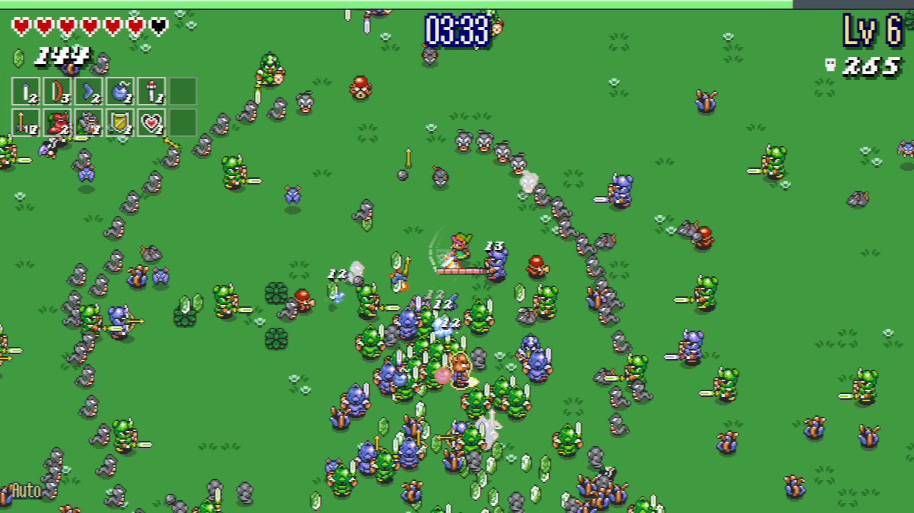
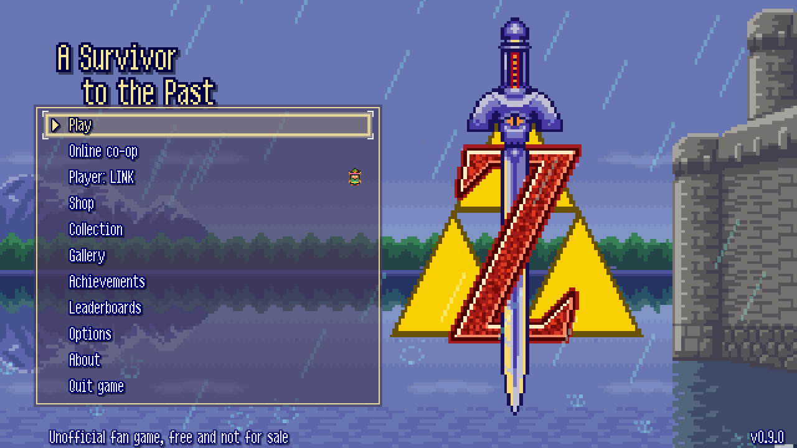

<p align="center"></p>
<h1 align="center">A Survivor to the Past</h1>
<p align="center"><i>Un survivors-like nel mondo di <b>A Link to the Past</b>: resisti alle orde di mostri di Hyrule.</i></p>
<p align="center"><a href="https://discord.gg/N8f62M2eaK"></a> <a href="https://github.com/BigFatDeuce/A-Survivor-to-the-Past/releases"></a> <a href="LICENSE"></a> </p>
<p align="center"><a href="https://github.com/BigFatDeuce/A-Survivor-to-the-Past/releases/latest"><b>⬇ Scarica</b></a> · <a href="https://a-survivor-to-the-past.holy-c.men/play/"><b>▶ Gioca nel browser</b></a></p>
<p align="center"><a href="README.md">English</a> · <a href="README.fr.md">Français</a> · <a href="README.de.md">Deutsch</a> · <a href="README.es.md">Español</a> · <b>Italiano</b> · <a href="README.pt.md">Português</a> · <a href="README.ja.md">日本語</a></p>

<p align="center"></p>

## Che cos'è?

**A Survivor to the Past** è un fan game non ufficiale, fatto per divertimento. Unisce la formula dei *survivors-like* (le tue armi attaccano da sole, le ondate non finiscono mai, ogni livello porta nuovi poteri) agli sprite, alle musiche e ai suoni di *The Legend of Zelda: A Link to the Past* (Super Nintendo, 1991).

Guida Link tra orde sempre più grandi, raccogli rupie per salire di livello, scegli un potenziamento su tre, apri i forzieri lasciati dalle élite e fai evolvere le tue armi nelle loro forme leggendarie. Ogni stage dura una decina di minuti: un boss intermedio arriva a 4:30, il boss finale a 9:00, e sconfiggerlo apre l'uscita. Tra una partita e l'altra, spendi le rupie in potenziamenti permanenti.

## Contenuti

- **10 stage** nell'ordine del gioco originale — Piana di Hyrule, Deserto del Mistero, Montagna della Morte, Castello di Hyrule, Palazzo delle Tenebre, Palude, Boschi Perduti, Villaggio dei Ladri, Lago ghiacciato e Piramide del Potere — ognuno con il suo meteo, la sua musica, il suo boss intermedio e il suo boss finale, fino ad Agahnim e Ganon
- **350 personaggi giocabili** in sei universi — il cast fatto a mano (Link, Link Minish, Sonic, Zelda, Mario, Vivi, Ganondorf, l'ultimo di tutti...) e più di 300 sprite della comunità del *A Link to the Past Randomizer*, ognuno con i suoi autori nei crediti e fino a quattro colori (maglia blu, maglia rossa, coniglio). Alcuni si sbloccano con le imprese (nemici, boss, livelli, stage), altri si comprano con le rupie rosse — ognuno con punti di forza, debolezze e arma iniziale
- Una **Bob-omb** rara che spazza via tutti i nemici sullo schermo, e **scenari distruttibili** che nascondono rupie, cuori, fate o il medaglione dell'Etere
- **Incontri** casuali: un campione errante aspetta da qualche parte, una freccia indica la strada — sconfiggilo per una benedizione, un potenziamento speciale o una reliquia che resta se vinci
- Un **Boo ladro** che divora le rupie rimaste a terra — prendilo per recuperarle tutte
- La **chiromante** dopo il boss finale (gioco dei forzieri, lascia o raddoppia) e una **strega** che vende pozioni per tutta la partita
- **18 armi** (sei vinte contro i boss intermedi) e la **Master Sword** sconfiggendo Ganon, ognuna con la sua **fusione**, e **12 oggetti passivi** — 6 slot per le armi e 6 per gli oggetti: ogni scelta conta
- **Più di 30 tipi di nemici** di Hyrule, **12 boss** (uno diverso in ogni stage) ed **élite** che lasciano forzieri
- **Progressi tra le partite**: il negozio di Kakariko (potenziamenti permanenti), le benedizioni della Grande Fata, una **reliquia** per ogni stage, 4 **difficoltà** e i **sigilli** di Ganon per guadagnare più rupie
- **Raccolta** (bestiario con schede animate, armi, oggetti, fusioni) e **Imprese** (59 trofei di bronzo, argento e oro, statistiche); esportazione / importazione del salvataggio come codice di testo; le rupie rosse comprano anche costumi, musiche e titoli per la classifica
- **5 giocatori** sullo stesso computer, ognuno con nome, avatar e progressi propri; un **punteggio** per ogni partita e **classifiche**: migliori punteggi per livello, tra i giocatori di casa e una **top 100 mondiale** per versione del gioco
- Un **libretto di istruzioni** nello stile dell'originale (PDF, inglese e francese)
- Attacchi automatici o **mira manuale** in qualsiasi momento — tastiera, mouse o controller, e **tutti i tasti sono riassegnabili**
- **Grafica, musica e suoni** originali di A Link to the Past per SNES
- **Filtri video retrò**: SNES, CRT, Scanlines, Game Boy Advance, Game Boy, più una modalità **4:3** — e **filtri audio** abbinati
- **7 lingue**: English, Français, Deutsch, Español, Italiano, Português, 日本語
- **Motore fatto in casa in Rust** (wgpu): migliaia di nemici sullo schermo, su Windows, Linux, macOS e **nel browser**

## Armi ed evoluzioni

| Arma | + Oggetto | Evoluzione (entrambi al livello massimo) |
|---|---|---|
| Spada del guerriero | Portacuore | **Spada temprata** |
| Arco | Faretra | **Frecce d'argento** |
| Boomerang | Pinne di Zora | **Boomerang magico** |
| Verga di fuoco | Lanterna | **Medaglione Bombos** |
| Verga di ghiaccio | Mezza magia | **Medaglione Etere** |
| Martello magico | Guanto del potere | **Medaglione Sisma** |
| Bombe | Scudo specchio | **Superbomba** |
| Bastone di Byrna | Mantello magico | **Girotondo di fate** |
| Rampino | Stivali di Pegaso | **Super rampino** |
| Polvere magica | Fungo | **Polvere della strega** |
| Bastone di Somaria | Libro di Mudora | **Grande Somaria** |
| Api | Retino | **Api dorate** |
| Fionda | Faretra | **Iperfionda** |
| Piuma di Roc | Stivali di Pegaso | **Mantello di Roc** |
| Lume | Mezza magia | **Lume blu** |
| Giara del vento | Mantello magico | **Giara di Vaati** |
| Ocarina delle fate | Libro di Mudora | **Ocarina del tempo** |
| Fuoco di Din | Lanterna | **Ira di Din** |

## Immagini

<table>
<tr>
<td width="50%" align="center"><br><sub>Schermata del titolo</sub></td>
<td width="50%" align="center"><br><sub>Scelta dello stage</sub></td>
</tr>
<tr>
<td width="50%" align="center"><br><sub>Scelta del personaggio</sub></td>
<td width="50%" align="center"><br><sub>Monte Morte (stage bonus) e i suoi Lynel</sub></td>
</tr>
<tr>
<td width="50%" align="center"><br><sub>Livello superiore: scegli 1 su 3</sub></td>
<td width="50%" align="center"><br><sub>Forziere dell'evoluzione</sub></td>
</tr>
<tr>
<td width="50%" align="center"><br><sub>Boss: Hinox</sub></td>
<td width="50%" align="center"><br><sub>Negozio di Kakariko: potenziamenti permanenti</sub></td>
</tr>
<tr>
<td width="50%" align="center"><br><sub>Opzioni (lingua, filtri, volumi)</sub></td>
<td width="50%" align="center"><br><sub>Informazioni</sub></td>
</tr>
</table>

<p align="center"><br><sub>Filtri video: nessuno · CRT / Game Boy Advance · Game Boy / Scanlines · CRT in 4:3</sub></p>

## Giocare

Il gioco è in **alfa** (versione 0.8.0). **Windows**: scarica l'ultima versione dalla [pagina delle release](https://github.com/BigFatDeuce/A-Survivor-to-the-Past/releases/latest), estrai tutto lo zip e avvia `A Survivor to the Past.exe`. Windows potrebbe avvisare che il gioco non è firmato: fai clic su *Ulteriori informazioni* → *Esegui comunque*. **Linux, macOS e console portatili** (PortMaster, sperimentale): stessa pagina, prendi lo zip del tuo sistema e segui il suo `README.txt`. **Android** (telefoni e tablet, comandi touch): stessa pagina, scarica l'`.apk` e aprilo (consenti l'installazione dal browser); non si aggiorna da solo. Poi il gioco **si aggiorna da solo**: all'avvio controlla su GitHub se c'è una nuova versione, la scarica in background e la installa all'avvio successivo (Opzioni → Aggiornamenti: Automatici / Chiedi / No). Le tue impostazioni restano e non viene inviato alcun dato personale: gli aggiornamenti contattano solo GitHub, e la classifica mondiale contatta il sito del gioco solo quando la apri o pubblichi un punteggio (soprannome e punteggio).

**Browser**: [gioca direttamente sul sito](https://a-survivor-to-the-past.holy-c.men/play/), senza installare nulla. Meglio su computer, con Chrome, Edge o Firefox; i progressi sono salvati nel browser. Le versioni per Linux, macOS e Android arriveranno più avanti. Nel frattempo puoi compilare il gioco dai sorgenti con [Rust](https://rustup.rs) (stable):

```sh
git clone https://github.com/BigFatDeuce/A-Survivor-to-the-Past.git
cd A-Survivor-to-the-Past
cargo run --release -p game
```

Su Linux installa anche i pacchetti di sviluppo di ALSA e udev (`libasound2-dev`, `libudev-dev`).

## Comandi

| Azione | Tastiera / mouse | Controller |
|---|---|---|
| Muoversi | WASD / frecce | Levetta sinistra / croce |
| Attaccare (modalità manuale) | J / clic sinistro | X / grilletto destro |
| Scatto | Spazio / clic destro | A / grilletto sinistro |
| Attacco automatico o manuale | Tab / R | Y |
| Pausa | Esc / P | Start |
| Schermo intero · info · cattura | F11 · F3 · F12 | Select · – · – |

## Tabella di marcia

- Mappe vere fatte a mano e altri personaggi giocabili
- Altri boss con attacchi e animazioni propri

## Comunità

È un progetto fatto per divertimento. Per altri progetti, condivisioni, idee, proposte o bug, vieni sul **[Discord](https://discord.gg/N8f62M2eaK)**.

Sito: [a-survivor-to-the-past.holy-c.men](https://a-survivor-to-the-past.holy-c.men/)

---

## Note legali

**A Survivor to the Past** è un **fan game non ufficiale, gratuito e non commerciale**, fatto per divertimento. **È vietato venderlo, in tutto o in parte.**

*The Legend of Zelda*, *A Link to the Past*, *The Minish Cap*, i loro personaggi, la grafica, le musiche e gli effetti sonori sono marchi e opere protette di **Nintendo**. Tutte le risorse Nintendo usate qui appartengono a Nintendo. Questo progetto non è affiliato, sponsorizzato né approvato da Nintendo.

La [licenza GPL-3.0](LICENSE) copre solo il codice sorgente scritto per questo progetto; non concede alcun diritto sulle risorse di Nintendo. Gli sprite sheet provengono dai rip condivisi dalla comunità di *The Spriters Resource* — grazie ai loro autori.

Il nome di ogni autore di rip o di sprite (Barack Obama, Mister Man, Nemau, Aztec Warrior, Deathbringer, Barubary, Vaati, Mister Mike, Ragnarockerbunny e molti altri) è elencato in **[CREDITS.md](CREDITS.md)**. Anche Mario e Tipo Timido appartengono a Nintendo; *Sonic the Hedgehog* è un marchio di **SEGA**, *Among Us* di **Innersloth**, Simon Belmont (*Castlevania*) di **Konami**, e Vivi (*Final Fantasy IX*) di **Square Enix**.

Titolari dei diritti: per far rimuovere un contenuto, aprite una issue o contattateci su [Discord](https://discord.gg/N8f62M2eaK).
