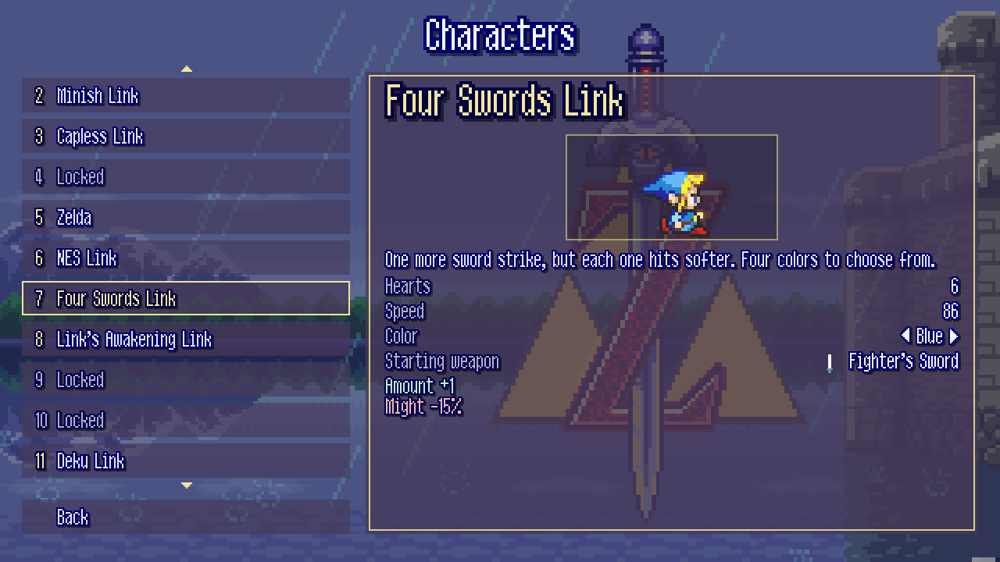
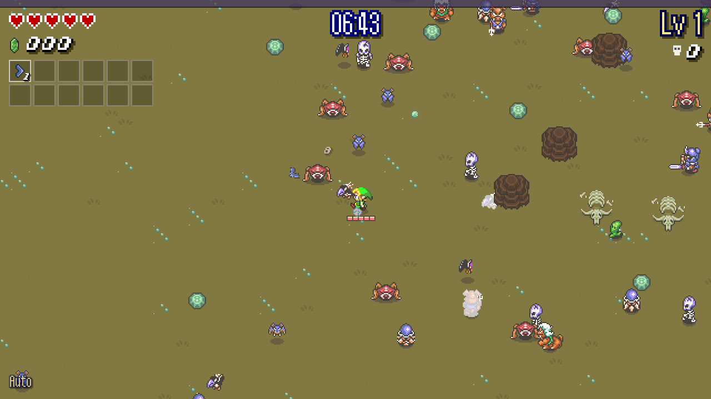

<p align="center"></p>
<h1 align="center">A Survivor to the Past</h1>
<p align="center"><i>A survivors-like in the world of <b>A Link to the Past</b>: hold out against hordes of Hyrule's monsters.</i></p>
<p align="center"><a href="https://discord.gg/N8f62M2eaK"></a> <a href="https://github.com/BigFatDeuce/A-Survivor-to-the-Past/releases"></a> <a href="LICENSE"></a> </p>
<p align="center"><a href="https://github.com/BigFatDeuce/A-Survivor-to-the-Past/releases/latest"><b>⬇ Download</b></a> · <a href="https://a-survivor-to-the-past.holy-c.men/play/"><b>▶ Play in your browser</b></a></p>
<p align="center"><b>English</b> · <a href="README.fr.md">Français</a> · <a href="README.de.md">Deutsch</a> · <a href="README.es.md">Español</a> · <a href="README.it.md">Italiano</a> · <a href="README.pt.md">Português</a> · <a href="README.ja.md">日本語</a></p>

<p align="center"></p>

## What is it?

**A Survivor to the Past** is an unofficial fan game made for fun. It mixes the formula of *survivors-like* games (your weapons attack on their own, the waves never stop, every level offers new powers) with the sprites, music and sounds of *The Legend of Zelda: A Link to the Past* (SNES, 1991).

Move Link through ever-growing hordes, pick up rupees to level up, choose one upgrade out of three, open the chests dropped by elites and evolve your weapons into their legendary forms. Each stage lasts about ten minutes: a mid-boss arrives at 4:30, the final boss at 9:00, and beating it opens the way out. Between runs, spend your rupees on permanent upgrades.

## Features

- **10 stages** in the order of the original game — Hyrule Field, Desert of Mystery, Death Mountain, Hyrule Castle, Palace of Darkness, Swamp, Lost Woods, Thieves' Town, Frozen Lake and the Pyramid of Power — each with its own weather, music, mid-boss and final boss, up to Agahnim and Ganon
- **357 playable characters** in six universes — the hand-made cast (Link, Minish Link, Sonic, Zelda, Mario, Vivi, the *Clair Obscur: Expedition 33* party, Ganondorf, the very last one...) and more than 300 sprites from the *A Link to the Past Randomizer* community, each with its authors credited and up to four colors (blue mail, red mail, bunny). Some are unlocked by feats (enemies, bosses, levels, stages), others are bought with red rupees — each with strengths, weaknesses and a starting weapon
- A rare **Bob-omb** that blows away every enemy on screen, and **breakable scenery** hiding rupees, hearts, fairies or the Ether medallion
- Random **encounters**: a wandering champion waits somewhere, an arrow shows the way — beat it for a blessing, a special weapon upgrade or a relic you keep if you win
- A **thief Boo** that steals your rupees bit by bit — catch it to get them back
- The **Fortune Teller** after the final boss (chest game, double or nothing) and a **Witch** who sells potions for the whole run
- **18 weapons** (six of them won from mid-bosses) and the **Master Sword** for beating Ganon, each with its **fusion**, and **12 passive items** — 6 weapon slots and 6 item slots, so every choice matters
- **More than 30 enemy types** from Hyrule, **12 bosses** (a different one on every stage) and **elites** that drop chests
- **Progression between runs**: the Kakariko shop (permanent upgrades), the Great Fairy's blessings, a **relic** won on each stage, 4 **difficulties** and Ganon's **seals** to earn more rupees
- **Collection** (bestiary with animated cards, detailed cards for weapons, items and fusions) and a **Gallery** where Link walks among his trophies, weapons, figurines and the statues of unlocked characters; **Achievements** (59 bronze, silver and gold trophies, statistics); save export / import as a text code; red rupees also buy outfits, jukebox tracks and leaderboard titles
- **5 players** on the same computer, each with a name, an avatar and their own progress; a **score** for every run and **leaderboards**: best scores per stage, between the players at home and a **world top 100** per game version, solo and co-op
- **Online co-op for 2 to 4 players** (computer, Android and browser): create a room and share its 4-letter code; everyone plays their own character and color, picks upgrades without pausing the others (protected for 10 seconds) and can revive fallen allies; enemies get tougher and more numerous with each player
- An **instruction booklet** in the style of the original one (PDF, English and French)
- Automatic attacks, or **manual aiming** at any time — keyboard, mouse or gamepad, and **every key can be remapped**
- Original SNES **graphics, music and sounds** of A Link to the Past
- **Retro video filters**: SNES, CRT, Scanlines, Game Boy Advance, Game Boy, plus a **4:3** mode — and matching **audio filters**
- **7 languages**: English, Français, Deutsch, Español, Italiano, Português, 日本語
- Home-made **Rust engine** (wgpu): thousands of enemies on screen, on Windows, Linux, macOS, **Android** and **in the browser**

## Weapons and evolutions

| Weapon | + Item | Evolution (both at max level) |
|---|---|---|
| Fighter's Sword | Heart Container | **Tempered Sword** |
| Bow | Quiver | **Silver Arrows** |
| Boomerang | Zora's Flippers | **Magical Boomerang** |
| Fire Rod | Lamp | **Bombos Medallion** |
| Ice Rod | Half Magic | **Ether Medallion** |
| Magic Hammer | Power Glove | **Quake Medallion** |
| Bombs | Mirror Shield | **Super Bomb** |
| Cane of Byrna | Magic Cape | **Fairy Ring** |
| Hookshot | Pegasus Boots | **Longshot** |
| Magic Powder | Mushroom | **Witch's Powder** |
| Cane of Somaria | Book of Mudora | **Great Somaria** |
| Bees | Bug-Catching Net | **Golden Bees** |
| Slingshot | Quiver | **Hyper Slingshot** |
| Roc's Feather | Pegasus Boots | **Roc's Cape** |
| Lantern | Half Magic | **Blue Lantern** |
| Gust Jar | Magic Cape | **Vaati's Jar** |
| Fairy Ocarina | Book of Mudora | **Ocarina of Time** |
| Din's Fire | Lamp | **Din's Wrath** |

## Screenshots

<table>
<tr>
<td width="50%" align="center"><br><sub>Title screen</sub></td>
<td width="50%" align="center"><br><sub>Stage select</sub></td>
</tr>
<tr>
<td width="50%" align="center"><br><sub>Character select</sub></td>
<td width="50%" align="center"><br><sub>Death Mountain (bonus stage) and its Lynels</sub></td>
</tr>
<tr>
<td width="50%" align="center"><br><sub>Level up: choose 1 of 3</sub></td>
<td width="50%" align="center"><br><sub>Evolution chest</sub></td>
</tr>
<tr>
<td width="50%" align="center"><br><sub>Boss: Hinox</sub></td>
<td width="50%" align="center"><br><sub>Kakariko shop: permanent upgrades</sub></td>
</tr>
<tr>
<td width="50%" align="center"><br><sub>Options (language, filters, volumes)</sub></td>
<td width="50%" align="center"><br><sub>About</sub></td>
</tr>
</table>

<p align="center"><br><sub>Video filters: none · CRT / Game Boy Advance · Game Boy / Scanlines · CRT in 4:3</sub></p>

## Play

The game is in **early alpha** (version 0.9.0). **Windows**: download the latest version from the [Releases page](https://github.com/BigFatDeuce/A-Survivor-to-the-Past/releases/latest), extract the whole zip and launch `A Survivor to the Past.exe`. Windows may warn that the game is not signed: click *More info* → *Run anyway*. **Linux, macOS and handhelds** (PortMaster, experimental): same page, take the zip for your system and follow its `README.txt`. **Android** (phones and tablets, touch controls): same page, download the `.apk` and open it (allow installs from your browser); it does not update itself. The game then **updates itself**: at launch it checks GitHub for a new version, downloads it in the background and installs it at the next launch (Options → Updates: Automatic / Ask me / Off). Your settings are kept and no personal data is sent: updates only contact GitHub, and the world leaderboard only contacts the game's website when you open it or publish a score (nickname and score).

**Browser**: [play directly on the website](https://a-survivor-to-the-past.holy-c.men/play/), nothing to install. It works best on a computer, in Chrome, Edge or Firefox, and your progress is saved in the browser. You can also build the game from source with [Rust](https://rustup.rs) (stable):

```sh
git clone https://github.com/BigFatDeuce/A-Survivor-to-the-Past.git
cd A-Survivor-to-the-Past
cargo run --release -p game
```

On Linux, also install the ALSA and udev development packages (`libasound2-dev`, `libudev-dev`).

## Controls

| Action | Keyboard / mouse | Gamepad |
|---|---|---|
| Move | WASD / arrows | Left stick / D-pad |
| Attack (manual mode) | J / left click | X / right trigger |
| Dash | Space / right click | A / left trigger |
| Auto or manual attack | Tab / R | Y |
| Pause | Esc / P | Start |
| Fullscreen · info · screenshot | F11 · F3 · F12 | Select · – · – |

## Roadmap

- Real hand-made maps and more playable characters
- More bosses with their own attacks and animations

## Community

This is a project made for fun. For other projects, sharing, ideas, suggestions or bug reports, come and talk on **[Discord](https://discord.gg/N8f62M2eaK)**.

Website: [a-survivor-to-the-past.holy-c.men](https://a-survivor-to-the-past.holy-c.men/)

---

## Legal

**A Survivor to the Past** is an **unofficial, free and non-commercial fan game**, made for fun. **Selling it, or any part of it, is forbidden.**

*The Legend of Zelda*, *A Link to the Past*, *The Minish Cap*, their characters, graphics, music and sound effects are trademarks and copyrighted works of **Nintendo**. All Nintendo assets used here belong to Nintendo. This project is not affiliated with, sponsored or endorsed by Nintendo.

The [GPL-3.0 license](LICENSE) only covers the source code written for this project; it grants no rights over Nintendo's assets. Sprite sheets come from the rips shared by the community of *The Spriters Resource* — thanks to their authors.

The name of every sprite ripper and artist (Barack Obama, Mister Man, Nemau, Aztec Warrior, Deathbringer, Barubary, Vaati, Mister Mike, Ragnarockerbunny and many more) is listed in **[CREDITS.md](CREDITS.md)**. Mario and Shy Guy also belong to Nintendo; *Sonic the Hedgehog* is a trademark of **SEGA**, *Among Us* of **Innersloth**, Simon Belmont (*Castlevania*) of **Konami**, Vivi (*Final Fantasy IX*) of **Square Enix**, and the *Clair Obscur: Expedition 33* characters of **Sandfall Interactive**.

Rights holders: to have content removed, open an issue or contact us on [Discord](https://discord.gg/N8f62M2eaK).
