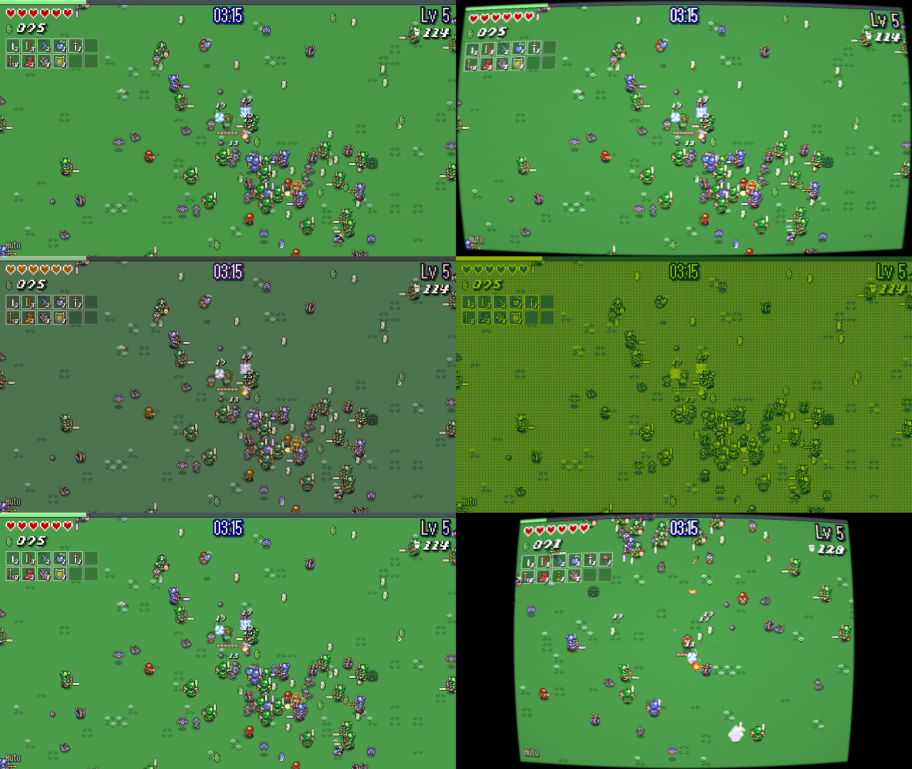

<p align="center"></p>
<h1 align="center">A Survivor to the Past</h1>
<p align="center"><i>A survivors-like in the world of <b>A Link to the Past</b>: hold out against hordes of Hyrule's monsters.</i></p>
<p align="center"><a href="https://discord.gg/N8f62M2eaK"></a> <a href="https://github.com/BigFatDeuce/A-Survivor-to-the-Past/releases"></a> <a href="LICENSE"></a> </p>
<p align="center"><a href="https://github.com/BigFatDeuce/A-Survivor-to-the-Past/releases/latest"><b>⬇ Download for Windows</b></a></p>
<p align="center"><b>English</b> · <a href="README.fr.md">Français</a> · <a href="README.de.md">Deutsch</a> · <a href="README.es.md">Español</a> · <a href="README.it.md">Italiano</a> · <a href="README.pt.md">Português</a> · <a href="README.ja.md">日本語</a></p>

<p align="center"></p>

## What is it?

**A Survivor to the Past** is an unofficial fan game made for fun. It mixes the formula of *survivors-like* games (your weapons attack on their own, the waves never stop, every level offers new powers) with the sprites, music and sounds of *The Legend of Zelda: A Link to the Past* (SNES, 1991).

Move Link through ever-growing hordes, pick up rupees to level up, choose one upgrade out of three, open the chests dropped by elites and evolve your weapons into their legendary forms. A boss shows up at 5:00.

## Features

- **8 weapons**, each with an **evolution**, and **8 passive items** — 6 weapon slots and 6 item slots, so every choice matters
- **15 enemy types** from Hyrule, **elites** that drop chests, and a **boss** (Hinox) at 5:00
- Automatic attacks, or **manual aiming** at any time (keyboard, mouse or gamepad)
- Original SNES **graphics, music and sounds** of A Link to the Past
- **Retro video filters**: SNES (default), CRT, Scanlines, Game Boy Advance, Game Boy, plus a **4:3** mode — and matching **audio filters**
- **7 languages**: English, Français, Deutsch, Español, Italiano, Português, 日本語
- Home-made **Rust engine** (wgpu): thousands of enemies on screen at a smooth frame rate

## Weapons and evolutions

| Weapon | + Item (any level) | Evolution (weapon at max level) |
|---|---|---|
| Fighter's Sword | Heart Container | **Master Sword** |
| Bow | Quiver | **Silver Arrows** |
| Boomerang | Pegasus Boots | **Magical Boomerang** |
| Fire Rod | Lamp | **Bombos Medallion** |
| Ice Rod | Half Magic | **Ether Medallion** |
| Magic Hammer | Power Glove | **Quake Medallion** |
| Bombs | Mirror Shield | **Super Bomb** |
| Cane of Byrna | Bug-Catching Net | **Fairy Ring** |

## Screenshots

<table>
<tr>
<td width="50%" align="center"><br><sub>Title screen</sub></td>
<td width="50%" align="center"><br><sub>Level up: choose 1 of 3</sub></td>
</tr>
<tr>
<td width="50%" align="center"><br><sub>Evolution chest</sub></td>
<td width="50%" align="center"><br><sub>Boss: Hinox</sub></td>
</tr>
<tr>
<td width="50%" align="center"><br><sub>Options (language, filters, volumes)</sub></td>
<td width="50%" align="center"><br><sub>About</sub></td>
</tr>
</table>

<p align="center"><br><sub>Video filters: none · CRT / Game Boy Advance · Game Boy / Scanlines · CRT in 4:3</sub></p>

## Play

The game is in **early alpha** (version 0.2.0). **Windows**: download the latest version from the [Releases page](https://github.com/BigFatDeuce/A-Survivor-to-the-Past/releases/latest), extract the whole zip and launch `A Survivor to the Past.exe`. Windows may warn that the game is not signed: click *More info* → *Run anyway*. The game then **updates itself**: at launch it checks GitHub for a new version, downloads it in the background and installs it at the next launch (Options → Updates: Automatic / Ask me / Off). Your settings are kept, and only GitHub is contacted, without any personal data.

Linux, macOS, Android and browser versions will come when the game is ready. Meanwhile you can build it from source with [Rust](https://rustup.rs) (stable):

```sh
git clone https://github.com/BigFatDeuce/A-Survivor-to-the-Past.git
cd A-Survivor-to-the-Past
cargo run --release -p game
```

On Linux, also install the ALSA and udev development packages (`libasound2-dev`, `libudev-dev`).

## Controls

| Action | Keyboard / mouse | Gamepad |
|---|---|---|
| Move | WASD / arrows | Left stick / D-pad |
| Attack (manual mode) | J / left click | X / right trigger |
| Dash | Space / right click | A / left trigger |
| Auto or manual attack | Tab / R | Y |
| Pause | Esc / P | Start |
| Fullscreen · info · screenshot | F11 · F3 · F12 |  |

## Roadmap

- Real maps (Light World first) and more playable characters
- Online leaderboard for each map, with a nickname of your choice
- Bestiary, armory and statistics
- Save export / import and automatic updates
- Builds for Windows, Linux, macOS, Android and the browser

## Community

This is a project made for fun. For other projects, sharing, ideas, suggestions or bug reports, come and talk on **[Discord](https://discord.gg/N8f62M2eaK)**.

Website: [a-survivor-to-the-past.holy-c.men](https://a-survivor-to-the-past.holy-c.men/)

---

## Legal

**A Survivor to the Past** is an **unofficial, free and non-commercial fan game**, made for fun. **Selling it, or any part of it, is forbidden.**

*The Legend of Zelda*, *A Link to the Past*, their characters, graphics, music and sound effects are trademarks and copyrighted works of **Nintendo**. All Nintendo assets used here belong to Nintendo. This project is not affiliated with, sponsored or endorsed by Nintendo.

The [GPL-3.0 license](LICENSE) only covers the source code written for this project; it grants no rights over Nintendo's assets. Sprite sheets come from the rips shared by the community of *The Spriters Resource* — thanks to their authors.

Rights holders: to have content removed, open an issue or contact us on [Discord](https://discord.gg/N8f62M2eaK).
