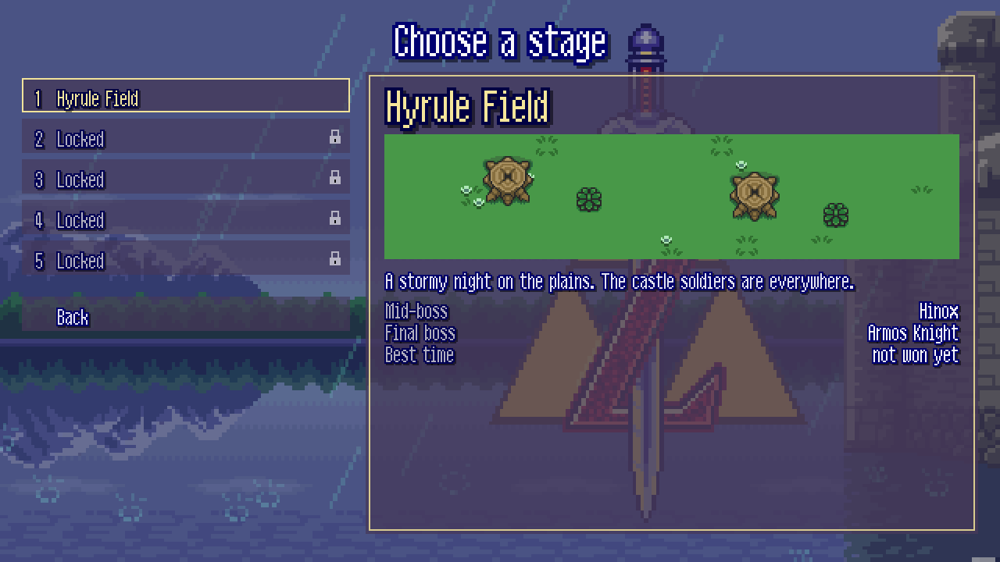

<p align="center"></p>
<h1 align="center">A Survivor to the Past</h1>
<p align="center"><i>Um survivors-like no mundo de <b>A Link to the Past</b>: resista às hordas de monstros de Hyrule.</i></p>
<p align="center"><a href="https://discord.gg/N8f62M2eaK"></a> <a href="https://github.com/BigFatDeuce/A-Survivor-to-the-Past/releases"></a> <a href="LICENSE"></a> </p>
<p align="center"><a href="https://github.com/BigFatDeuce/A-Survivor-to-the-Past/releases/latest"><b>⬇ Baixar para Windows</b></a> · <a href="https://a-survivor-to-the-past.holy-c.men/play/"><b>▶ Jogar no navegador</b></a></p>
<p align="center"><a href="README.md">English</a> · <a href="README.fr.md">Français</a> · <a href="README.de.md">Deutsch</a> · <a href="README.es.md">Español</a> · <a href="README.it.md">Italiano</a> · <b>Português</b> · <a href="README.ja.md">日本語</a></p>

<p align="center"></p>

## O que é?

**A Survivor to the Past** é um fangame não oficial, feito por diversão. Ele mistura a fórmula dos *survivors-like* (suas armas atacam sozinhas, as ondas nunca param, cada nível traz novos poderes) com os sprites, músicas e sons de *The Legend of Zelda: A Link to the Past* (Super Nintendo, 1991).

Guie Link no meio de hordas cada vez maiores, colete rupias para subir de nível, escolha uma melhoria entre três, abra os baús deixados pelas elites e evolua suas armas para as formas lendárias. Cada fase dura uns dez minutos: um chefe intermediário chega aos 4:30, o chefe final aos 9:00, e vencê-lo abre a saída. Entre as partidas, gaste suas rupias em melhorias permanentes.

## Conteúdo

- **5 fases** desbloqueadas uma após a outra — Campo de Hyrule, Bosque Perdido, Deserto do Mistério, Lago congelado e Pirâmide do Poder — cada uma com seu clima, sua música, um chefe intermediário e um chefe final, até Agahnim e Ganon
- **8 armas**, cada uma com uma **evolução**, e **8 itens passivos** — 6 espaços de armas e 6 de itens: cada escolha conta
- **15 tipos de inimigos** de Hyrule, **7 chefes** e **elites** que deixam baús
- **Progressão entre partidas**: a loja de Kakariko (melhorias permanentes), as bênçãos da Grande Fada, uma **relíquia** por fase, 4 **dificuldades** e os **selos** de Ganon para ganhar mais rupias
- **Perfil**: bestiário, arsenal, estatísticas, e exportar / importar o progresso como código de texto
- Ataques automáticos ou **mira manual** a qualquer momento — teclado, mouse ou controle, e **todas as teclas podem ser reconfiguradas**
- **Gráficos, músicas e sons** originais de A Link to the Past no SNES
- **Filtros de vídeo retrô**: SNES, CRT, Scanlines, Game Boy Advance, Game Boy, mais um modo **4:3** — e **filtros de áudio** combinando
- **7 idiomas**: English, Français, Deutsch, Español, Italiano, Português, 日本語
- **Motor próprio em Rust** (wgpu): milhares de inimigos na tela, no Windows e **no navegador**

## Armas e evoluções

| Arma | + Item (qualquer nível) | Evolução (arma no nível máximo) |
|---|---|---|
| Espada do guerreiro | Recipiente de coração | **Espada Mestra** |
| Arco | Aljava | **Flechas de prata** |
| Bumerangue | Botas de Pégaso | **Bumerangue mágico** |
| Bastão de fogo | Lamparina | **Medalhão Bombos** |
| Bastão de gelo | Meia magia | **Medalhão Éter** |
| Martelo mágico | Luva de poder | **Medalhão Tremor** |
| Bombas | Escudo espelhado | **Superbomba** |
| Cetro de Byrna | Rede de insetos | **Roda de fadas** |

## Imagens

<table>
<tr>
<td width="50%" align="center"><br><sub>Tela de título</sub></td>
<td width="50%" align="center"><br><sub>Seleção de fase</sub></td>
</tr>
<tr>
<td width="50%" align="center"><br><sub>Subir de nível: escolha 1 de 3</sub></td>
<td width="50%" align="center"><br><sub>Baú de evolução</sub></td>
</tr>
<tr>
<td width="50%" align="center"><br><sub>Chefe: Hinox</sub></td>
<td width="50%" align="center"><br><sub>Loja de Kakariko: melhorias permanentes</sub></td>
</tr>
<tr>
<td width="50%" align="center"><br><sub>Opções (idioma, filtros, volumes)</sub></td>
<td width="50%" align="center"><br><sub>Sobre</sub></td>
</tr>
</table>

<p align="center"><br><sub>Filtros de vídeo: nenhum · CRT / Game Boy Advance · Game Boy / Scanlines · CRT em 4:3</sub></p>

## Jogar

O jogo está em **alfa** (versão 0.3.0). **Windows**: baixe a versão mais recente na [página de versões](https://github.com/BigFatDeuce/A-Survivor-to-the-Past/releases/latest), extraia o zip inteiro e abra `A Survivor to the Past.exe`. O Windows pode avisar que o jogo não é assinado: clique em *Mais informações* → *Executar assim mesmo*. Depois, o jogo **se atualiza sozinho**: ao iniciar, ele verifica no GitHub se há uma nova versão, baixa em segundo plano e instala no próximo início (Opções → Atualizações: Automáticas / Perguntar / Não). Suas configurações são mantidas e só o GitHub é contatado, sem nenhum dado pessoal.

**Navegador**: [jogue direto no site](https://a-survivor-to-the-past.holy-c.men/play/), sem instalar nada. Funciona melhor no computador, no Chrome, Edge ou Firefox, e seu progresso fica salvo no navegador. As versões para Linux, macOS e Android virão depois. Enquanto isso, você pode compilar o jogo a partir do código-fonte com [Rust](https://rustup.rs) (stable):

```sh
git clone https://github.com/BigFatDeuce/A-Survivor-to-the-Past.git
cd A-Survivor-to-the-Past
cargo run --release -p game
```

No Linux, instale também os pacotes de desenvolvimento do ALSA e do udev (`libasound2-dev`, `libudev-dev`).

## Controles

| Ação | Teclado / mouse | Controle |
|---|---|---|
| Mover | WASD / setas | Analógico esquerdo / direcional |
| Atacar (modo manual) | J / clique esquerdo | X / gatilho direito |
| Investida | Espaço / clique direito | A / gatilho esquerdo |
| Ataque automático ou manual | Tab / R | Y |
| Pausa | Esc / P | Start |
| Tela cheia · info · captura | F11 · F3 · F12 |  |

## Próximos passos

- Mapas de verdade feitos à mão e mais personagens jogáveis
- Ranking online para cada fase, com um apelido à sua escolha
- Mais chefes com ataques e animações próprios
- Controles de toque para celulares e tablets
- Versões para Linux, macOS e Android

## Comunidade

É um projeto feito por diversão. Para outros projetos, compartilhar, ideias, sugestões ou bugs, venha para o **[Discord](https://discord.gg/N8f62M2eaK)**.

Site: [a-survivor-to-the-past.holy-c.men](https://a-survivor-to-the-past.holy-c.men/)

---

## Aviso legal

**A Survivor to the Past** é um **fangame não oficial, gratuito e sem fins comerciais**, feito por diversão. **É proibido vendê-lo, no todo ou em parte.**

*The Legend of Zelda*, *A Link to the Past*, seus personagens, gráficos, músicas e efeitos sonoros são marcas e obras protegidas da **Nintendo**. Todos os recursos da Nintendo usados aqui pertencem à Nintendo. Este projeto não é afiliado, patrocinado nem endossado pela Nintendo.

A [licença GPL-3.0](LICENSE) cobre apenas o código-fonte escrito para este projeto; ela não concede nenhum direito sobre os recursos da Nintendo. As folhas de sprites vêm das extrações compartilhadas pela comunidade do *The Spriters Resource* — obrigado aos seus autores.

Detentores de direitos: para remover um conteúdo, abram uma issue ou falem conosco no [Discord](https://discord.gg/N8f62M2eaK).
